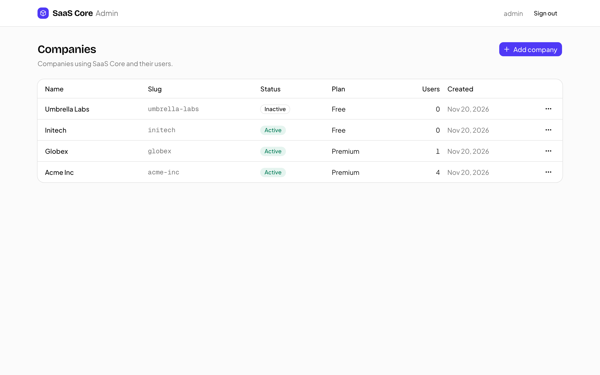
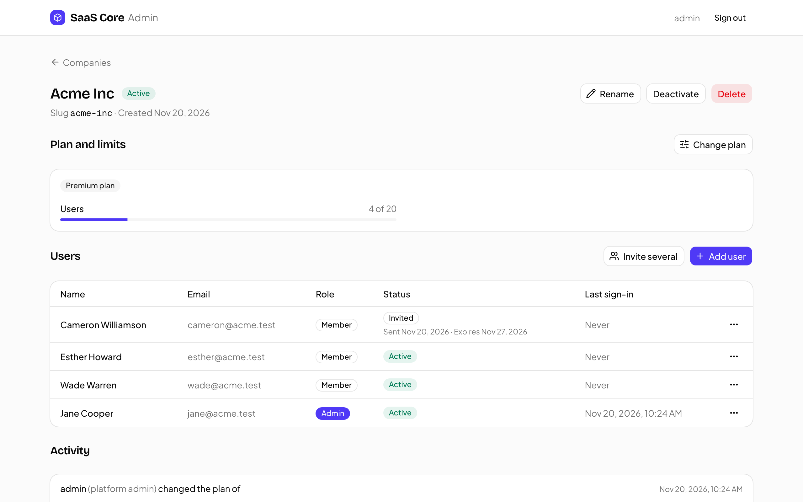
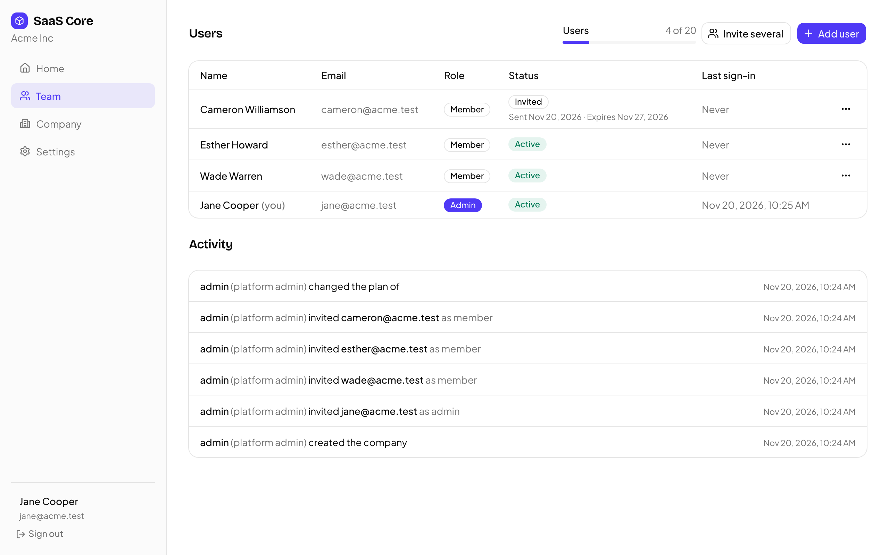
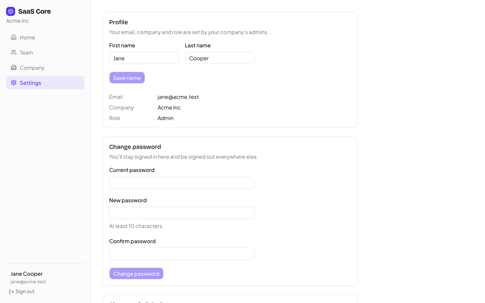

# SaaS Core

A base for multi-tenant SaaS products. Each company is its own workspace (like Slack).

## Screenshots

| Platform admin: companies                          | Platform admin: a company                      |
| -------------------------------------------------- | ---------------------------------------------- |
|  |  |
| **Company admin: team**                            | **Settings**                                   |
|                  |      |

## Features

Platform admin (`/admin`)

- Company management: create, rename, activate or deactivate, delete, change the plan
- User management: invite users, one at a time or in bulk
- Role management: company admin or member
- Company activity log

Company admin

- Manage the team: invite, edit, change roles, deactivate, delete
- Rename the company

Every user

- Settings: personal info, change password, sign out everywhere

## Tech features

- One TypeScript stack for the whole codebase
- Server-client type generation from OpenAPI, so more clients can be added
- Prisma ORM for the database layer
- Testing
  - End-to-end tests (Playwright), in local mode or staging mode
  - Integration tests against real Postgres, using Testcontainers
- Background job queue backed by Postgres ([docs/jobs.md](docs/jobs.md))

## Layout

| Folder                    | What it is                                                                                        |
| ------------------------- | ------------------------------------------------------------------------------------------------- |
| [`ui/`](ui)               | Next.js: user pages and admin pages (`/admin`). No database access.                               |
| [`backend/`](backend)     | Fastify API and job worker. Internal only.                                                        |
| [`shared/`](shared)       | Constants and helpers; `/db` (Prisma client), `/db/test-helpers`, `/security`, `/test-containers` |
| [`e2e/`](e2e)             | Playwright tests                                                                                  |
| [`prisma/`](prisma)       | Database schema and migrations                                                                    |
| [`local-dev/`](local-dev) | Docker Compose for Postgres and Mailpit; `run.sh` starts everything                               |
| [`docs/`](docs)           | How it works                                                                                      |

## Quick start

Requirements: Node.js 22.12+, pnpm, Docker or Podman.

```sh
./local-dev/run.sh         # containers, migrations, API, worker, UI
pnpm admin:create          # once, in another terminal: a platform admin
```

Sign in at http://localhost:3000/admin. Emails land in Mailpit (http://localhost:8025).

## Deploying to production

`pnpm images:build [--push]` ([scripts/build-images.sh](scripts/build-images.sh)) builds two images with Docker or Podman:

- `saas-core-backend`: the API by default. Run the worker with `node dist/worker.js`. Migrations and `admin:create` also run from this image.
- `saas-core-ui`: Next.js standalone.

`IMAGE_TAG` (default: the git commit), `IMAGE_REGISTRY` (e.g. `ghcr.io/acme`) and `PLATFORM` (e.g. `linux/amd64`) set the image names and target platform.

In production, a reverse proxy sends `/api/*` to the backend and everything else to the UI ([local-dev/Caddyfile](local-dev/Caddyfile)). The backend must only be reachable through it. To run the images locally that way (http://localhost:8080):

```sh
cd local-dev && docker compose -f docker-compose.yml -f docker-compose.images.yml up
```

## Database

Roles: `saas` owns the schema and runs migrations (`DB_MIGRATION_*`); `saas_app` is the backend's restricted role (`DB_USERNAME`).

### Updating the DB schema

1. Change [prisma/schema.prisma](prisma/schema.prisma).
2. `pnpm db:migrate` creates the migration and applies it locally. A new table needs `GRANT SELECT, INSERT, UPDATE, DELETE ON <table> TO saas_app` in its migration.
3. `pnpm db:deploy` applies pending migrations, e.g. in production.

## Docs

- [Architecture](docs/architecture.md)
- [Jobs](docs/jobs.md)
